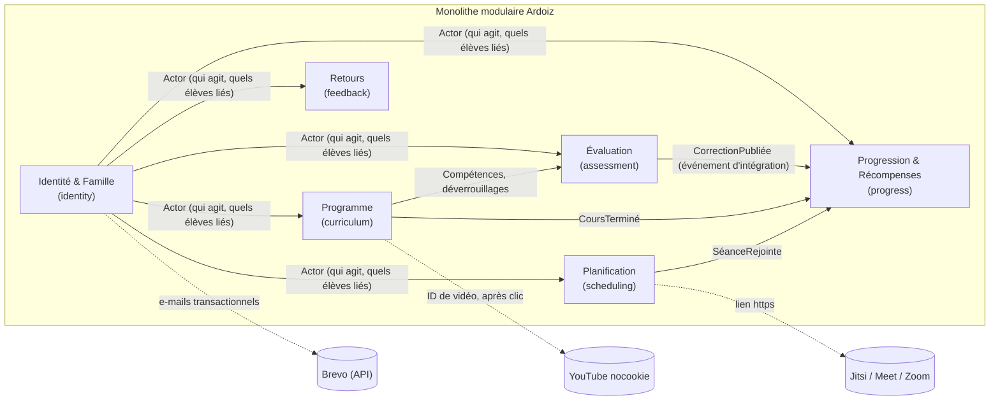

# Architecture — contextes, modules et stack

> **Phase 2 · Livrable** · Carte des contextes, découpage du monolithe modulaire, stack technique.

## 1. Carte des contextes



| Contexte | Module | Rôle | Relation |
|---|---|---|---|
| Identité & Famille | `identity` | Comptes, sessions, 2FA, liens parentaux, consentement, invitations | **Fournisseur** : expose l'`Actor` (rôle, espace, élèves liés) à tous les autres |
| Programme | `curriculum` | Matières, compétences, modules, cours, groupes, déverrouillages, médias | Fournisseur de l'Évaluation (compétences, accès) |
| Planification | `scheduling` | Séances, récurrence, participants, lien visio | Publie `SéanceRejointe` |
| Évaluation | `assessment` | Épreuves, attributions, tentatives, cahier virtuel, correction | Publie `CorrectionPubliée`, `CopieRendue` |
| Progression & Récompenses | `progress` | Preuves, niveaux de compétence, notes, XP, badges, séries ; projections du tableau de bord | **Conformiste** : ne fait que consommer des événements ; aucune écriture vers les autres |
| Retours | `feedback` | Suggestions | Isolé |
| Noyau partagé | `shared-kernel` | Identifiants typés, `TutorSpaceId`, `Clock`, `DomainError`, `Result` | Minimal, stable |
| Plateforme | `platform` | HTTP, persistance, outbox, e-mail, stockage de fichiers, configuration, logs | Adaptateurs uniquement |

**Règle de dépendance** (vérifiée par dependency-cruiser) : un module n'importe jamais l'intérieur d'un autre module ; il passe par son `index.ts` public (ports, DTO, événements d'intégration). `domain/` n'importe ni `application/`, ni `infrastructure/`, ni aucune bibliothèque d'E/S.

## 2. Couches par module (hexagonal)

```
apps/api/src/<module>/
  domain/          # agrégats, Value Objects, événements de domaine, erreurs : TypeScript pur
  application/     # cas d'usage, politiques d'accès (allow/deny/hide), ports
  infrastructure/  # repositories Postgres, adaptateurs, routes HTTP du module
  index.ts         # API publique du module
```

## 3. Arborescence du dépôt

```
ardoiz/
  apps/
    api/            # Fastify + domaine (Node LTS)
    web/            # React + Vite (SPA servie par l'API, même origine)
  packages/
    contracts/      # schémas TypeBox partagés (requêtes/réponses), types générés
    content-schema/ # schéma du document de cours (nœuds autorisés) + validateur, partagé front/back
  db/migrations/    # SQL versionné (001_..., 002_...)
  features/         # Gherkin exécutable
  deploy/           # Dockerfile, compose de prod (labels Traefik), scripts
  .github/workflows/
  docs/             # ce dossier
```

Outils : **npm workspaces** (comme le code compagnon du livre).

## 4. Stack

| Couche | Choix | Raison |
|---|---|---|
| Langage | TypeScript `strict` + `noUncheckedIndexedAccess` + `exactOptionalPropertyTypes` | Continuité avec le livre |
| Runtime | Node.js LTS active (24 à la date du cadrage) | |
| API | Fastify, `@fastify/cookie`, `@fastify/rate-limit`, `@fastify/helmet`, `@fastify/static`, TypeBox + ajv (`removeAdditional: false`, `additionalProperties: false`) | Validation stricte, rapide, déjà éprouvé dans le livre (ch. 5b) |
| Base | PostgreSQL (instance partagée du serveur, **base et rôles dédiés**), driver `pg`, SQL écrit à la main, migrations SQL versionnées | RLS, contraintes, exclusions : la base est un gardien (ADR-0002) |
| Mots de passe | argon2id (`@node-rs/argon2`) | |
| 2FA | TOTP (RFC 6238), secret chiffré AES-256-GCM | |
| Front | React, Vite, React Router, TanStack Query | Excalidraw est un composant React |
| Éditeur de cours | TipTap (cœur MIT) avec nœuds limités au schéma `content-schema` ; formules KaTeX | Schéma fermé, sortie JSON validable côté serveur |
| Cahier virtuel | `@excalidraw/excalidraw` (MIT), MathLive (MIT) pour les formules | ADR-0004 |
| Rendu mathématique | KaTeX (MIT), `trust: false`, `maxSize`, `maxExpand` bornés | |
| Images | `sharp` : réencodage WebP, suppression EXIF, dimensions bornées | R14 |
| E-mail | Port `Mailer` ; adaptateur **Brevo API HTTP** (`POST https://api.brevo.com/v3/smtp/email`, header `api-key`, délai 10 s) en prod, adaptateur SMTP vers Mailpit en dev | Convention des autres projets du serveur. L'adaptateur ne journalise **pas** l'adresse du destinataire en clair (R21) |
| Fichiers | Port `FileStorage` ; adaptateur volume local au J1 (S3 compatible plus tard) ; servis par une route autorisée, jamais en statique public | R3, R14 |
| Tests | Vitest, Testcontainers (Postgres réel), `@cucumber/gherkin` pour les features, Playwright (E2E) | Pyramide du ch. 6 du livre |
| Qualité | ESLint (typescript-eslint strict), Prettier, dependency-cruiser, `npm audit`, gitleaks, SBOM CycloneDX | |
| CI/CD | GitHub Actions (actions épinglées par SHA), image publique sur Docker Hub, déploiement SSH sur Hetzner sur tag `v*` avec approbation, sans staging | ADR-0008 (amendé) |
| Observabilité | Logs JSON (pino) collectés par Alloy → Loki ; métriques Prometheus `/metrics` sur le port **9464**, jamais routé par Traefik | Stack déjà en place |

**Licences** : toute dépendance runtime doit être sous licence permissive (MIT, Apache-2.0, BSD, ISC, BlueOak-1.0.0, 0BSD). Vérification automatique en CI (`license-checker` avec liste blanche). Pas de tldraw (licence commerciale en production), pas de GeoGebra (usage non commercial uniquement), pas d'extensions TipTap « Pro ».

## 5. Modèle des agrégats (indicatif, à affiner au lot concerné)

| Module | Agrégat | Invariants principaux |
|---|---|---|
| identity | `Account` (tuteur/parent/élève), `Guardianship`, `Invitation`, `ParentalConsent` | Rôle immuable ; un élève a ≥ 1 lien parental actif ; invitation consommée une seule fois |
| curriculum | `Subject` (+ `Competency`), `Module`, `Lesson`, `Group`, `Unlock` | Le contenu d'un cours respecte le schéma ; un déverrouillage vise un élève ou un groupe du même espace |
| scheduling | `TutoringSession` (+ règle de récurrence) | Fin > début ; durée ≤ 4 h ; lien visio valide |
| assessment | `Assessment` (+ `Question`), `Assignment`, `Attempt` | Tentatives ≤ maximum ; écriture uniquement en `draft` ; copie rendue immuable ; note calculée côté serveur |
| progress | `LearnerProgress` (preuves, niveaux, XP, série, badges) | Badge obtenu une seule fois ; XP jamais négatif ; projection reconstructible depuis les événements |
| feedback | `Suggestion` | Auteur = parent lié à l'élève concerné |

Les événements d'intégration passent par une **outbox** transactionnelle et une **inbox** idempotente (ch. 5a du livre), même dans un monolithe : `progress` doit pouvoir être reconstruit et ne jamais bloquer une correction.
