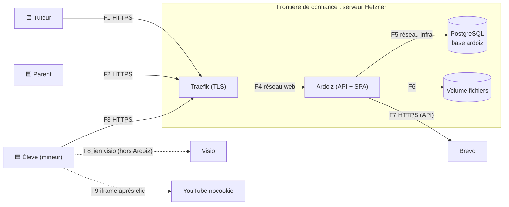

# Registre des menaces

> **Phase 3 · Livrable** · Menaces identifiées par STRIDE sur le flux de données, rattachées à l'OWASP Top 10 **2025**.
> Chaque menace a au moins une règle dans `catalogue-des-regles.md`.

## 1. Flux de données (niveau 0)

Actifs critiques : **données scolaires des mineurs**, comptes (surtout le compte tuteur), intégrité des notes, liens de visio.

## 2. Menaces

| ID | Menace (scénario) | STRIDE | OWASP 2025 | Impact | Vraisemblance | Règles |
|---|---|---|---|---|---|---|
| M1 | Un adulte se fait passer pour le parent d'un enfant (invitation interceptée ou rejouée, lien parental créé sans contrôle) et accède à ses données | Usurpation | A01, A07 | Critique | Moyenne | R1, R12 |
| M2 | Un parent ou un élève lit les données d'un autre élève en changeant un identifiant dans l'URL ou l'API (IDOR / BOLA) | Divulgation | A01 | Critique | Élevée | R2, R10 |
| M3 | Une donnée d'un espace tuteur fuit vers un autre (après l'ouverture multi-tuteurs) | Divulgation | A01 | Critique | Moyenne | R10 |
| M4 | XSS stockée via un cours (HTML, formule KaTeX, lien), un texte du cahier, un prénom ou une suggestion : vol de session d'un enfant ou du tuteur | Altération, Élévation | A05 | Critique | Élevée | R4, R11 |
| M5 | Un élève accède à un cours ou à un média non déverrouillé par URL directe | Divulgation | A01 | Faible à moyen | Élevée | R3 |
| M6 | Triche : l'élève lit les réponses attendues dans le réseau ou le JS, modifie sa note côté client, rend après l'échéance ou rejoue une tentative | Altération | A06, A01 | Moyen | Élevée (enfants curieux) | R5 |
| M7 | Une copie est modifiée après avoir été rendue, ou une note est changée sans trace (par erreur ou par un compte compromis) | Altération, Répudiation | A08 | Moyen | Moyenne | R6, R12 |
| M8 | Compromission du compte tuteur (mot de passe réutilisé, hameçonnage) : accès à toutes les données de mineurs et à la publication de contenu | Usurpation | A07 | Critique | Moyenne | R7, R8, R12 |
| M9 | Force brute ou devinette sur un compte élève (pseudo prévisible, mot de passe faible), énumération de comptes | Usurpation | A07 | Élevé | Élevée | R8 |
| M10 | Le lien de visio fuit (capture d'écran, partage, e-mail transféré) et un inconnu rejoint une séance avec des mineurs | Divulgation | A01, A06 | Critique | Moyenne | R9 |
| M11 | Collecte excessive ou conservation illimitée des données de mineurs ; absence de preuve du consentement parental (non-conformité RGPD) | Divulgation | A06 | Élevé (légal) | Élevée si non traité | R16 |
| M12 | YouTube piste l'enfant ou lui suggère des vidéos inappropriées en fin de lecture | Divulgation | A06 | Moyen | Élevée | R13 |
| M13 | Fichier piégé : SVG avec script, polyglotte image/HTML, bombe de décompression, image géante, métadonnées GPS d'une photo prise chez l'enfant | Altération, Divulgation, Déni | A05, A06 | Élevé | Moyenne | R14, R15 |
| M14 | Saturation : scènes de cahier énormes, sauvegardes automatiques en rafale, spam de suggestions | Déni de service | A06 | Moyen | Moyenne | R15 |
| M15 | Requête forgée depuis un autre site exécutée avec la session d'un utilisateur (CSRF), clickjacking | Altération | A01 | Élevé | Faible (avec cookies SameSite) | R11 |
| M16 | Une vérification échoue techniquement (base indisponible, schéma invalide, exception) et l'accès est accordé par défaut | Élévation | A10 | Élevé | Moyenne | R18 |
| M17 | Dépendance npm compromise ou action GitHub détournée (arbre de dépendances d'Excalidraw et de TipTap volumineux) | Altération | A03 | Critique | Moyenne | R19 |
| M18 | Secret dans le dépôt ou l'image, configuration de production faible (en-têtes manquants, mode debug, base exposée) | Divulgation | A02, A04 | Élevé | Moyenne | R20, R11 |
| M19 | Journaux insuffisants pour reconstituer un incident, ou au contraire journaux contenant copies, mots de passe ou jetons | Répudiation, Divulgation | A09 | Moyen | Moyenne | R12, R21 |
| M20 | Mécaniques de jeu nuisibles pour des enfants : classement humiliant, pression des séries, notifications compulsives | (éthique, conception adaptée à l'âge) | A06 | Moyen | Élevée si non traité | R17 |
| M21 | Session d'un enfant laissée ouverte sur un ordinateur partagé, ou session volée réutilisée longtemps | Usurpation | A07 | Moyen | Moyenne | R8 |
| M22 | Altération inter-espaces via le relais de l'outbox : les fonctions `messaging.claim_pending_events` et `messaging.mark_events_published` (`SECURITY DEFINER`) sont appelables par le rôle applicatif depuis n'importe quel code ; un bug ou une injection SQL pourrait marquer « publié » un événement d'un autre espace (perte silencieuse de progression) ou lister les identifiants d'espaces | Altération, Divulgation | A01 | Moyen | Faible | R10 |

## 3. Fiches détaillées des menaces critiques

### M1 — Usurpation du lien parental
- **Scénario** : l'e-mail d'invitation est transféré ou intercepté, ou un parent A tente de se lier à l'enfant de la famille B.
- **Contre-mesures** : jeton aléatoire de 256 bits, stocké haché (SHA-256), usage unique, valable 72 h, lié à l'adresse invitée ; la création d'un élève n'est possible que par un parent consentant ; un co-parent n'est lié que sur invitation d'un parent **déjà lié** ; le tuteur voit tous les liens et peut en révoquer ; chaque lien est journalisé.
- **Test d'abus** : rejouer un jeton consommé, utiliser un jeton expiré, inviter un co-parent pour un enfant qui n'est pas le sien → refus, avec la même réponse que pour une ressource inexistante.

### M2 — Accès aux données d'un autre élève
- **Contre-mesures** : chaque cas d'usage reçoit l'`Actor` issu de la session ; une politique `allow/deny/hide` décide ; une ressource non autorisée répond **404** (hide) ; RLS Postgres en seconde ligne ; identifiants UUIDv7 préfixés non devinables (défense en profondeur seulement, jamais une protection en soi).
- **Test d'abus** : matrice de droits exécutée sur chaque route (parent A → élève de B, élève → élève, élève → vue tuteur).

### M4 — XSS stockée
- **Contre-mesures** : pas de HTML libre ; le contenu de cours est un document JSON validé contre un schéma fermé (nœuds et marques autorisés, URL `https:` uniquement, vidéos par identifiant YouTube) ; React sans `dangerouslySetInnerHTML` sauf dans un composant unique de rendu KaTeX (`trust: false`) ; CSP stricte sans `unsafe-inline` pour les scripts ; l'import HTML (J2) passe par DOMPurify puis une conversion vers le schéma.

### M6 — Triche
- **Contre-mesures** : la réponse attendue, la tolérance et le corrigé ne quittent jamais le serveur avant `CorrectionPubliée` ; correction calculée côté serveur ; fenêtre et nombre de tentatives contrôlés côté serveur, avec l'horloge du serveur ; une seule tentative `draft` à la fois.

### M8 — Compromission du compte tuteur
- **Contre-mesures** : TOTP obligatoire ; codes de secours hachés ; limitation de débit et verrouillage progressif ; réauthentification pour les actions sensibles (désactiver la 2FA, supprimer un élève, exporter) ; alerte e-mail à chaque nouvelle connexion du tuteur ; sessions révocables.

### M10 — Fuite du lien de visio
- **Contre-mesures** : le lien n'est servi qu'aux participants authentifiés, de 15 minutes avant le début jusqu'à la fin ; il n'est jamais dans un e-mail ni dans une notification ; il est validé sur une liste d'hôtes (`meet.jit.si`, `meet.google.com`, `*.zoom.us`, plus un hôte Jitsi configurable) ; le tuteur est invité, dans l'interface, à activer la salle d'attente ou le mot de passe de salle ; le tuteur peut régénérer le lien d'une séance.

## 4. Risques acceptés

| Risque | Raison |
|---|---|
| Un élève photographie l'écran pour partager une épreuve | Hors de portée technique ; enjeu faible en contexte familial |
| La plateforme de visio elle-même | Hors périmètre ; le choix de Jitsi auto-hébergé reste possible plus tard |
| Un parent consulte le compte de son enfant avec le mot de passe de l'enfant | Légitime : le parent est responsable du compte |
| M22 — altération inter-espaces via le relais de l'outbox | Accepté au J1 (un seul espace), verdict du lot 00. À traiter avant l'ouverture multi-tuteurs (J3) : rôle dédié `ardoiz_relay` ou relais dans un processus séparé |
